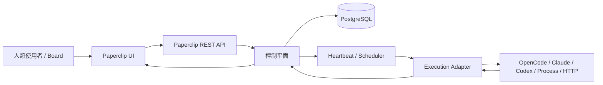
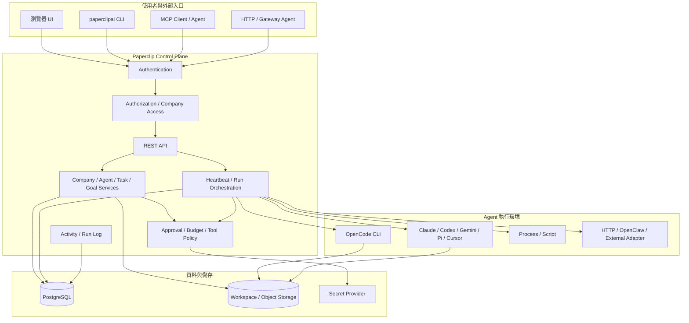
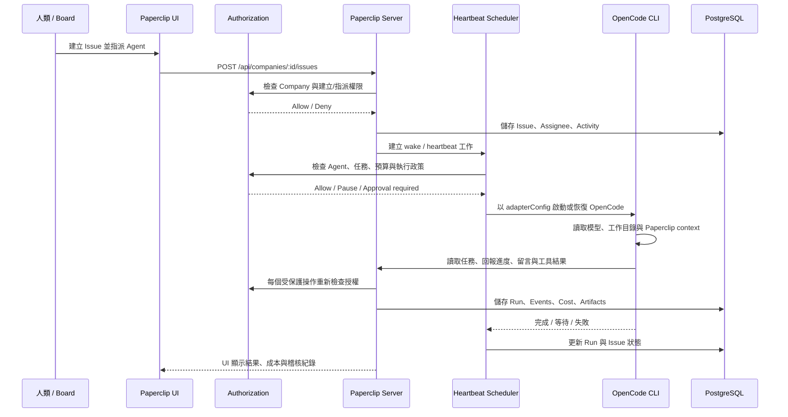
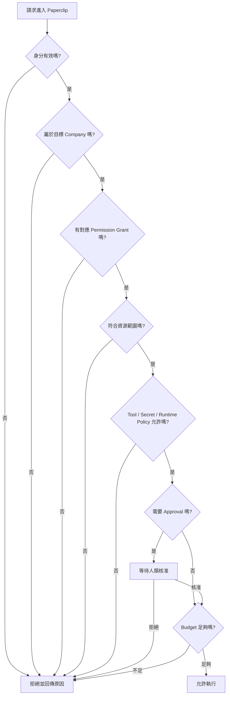
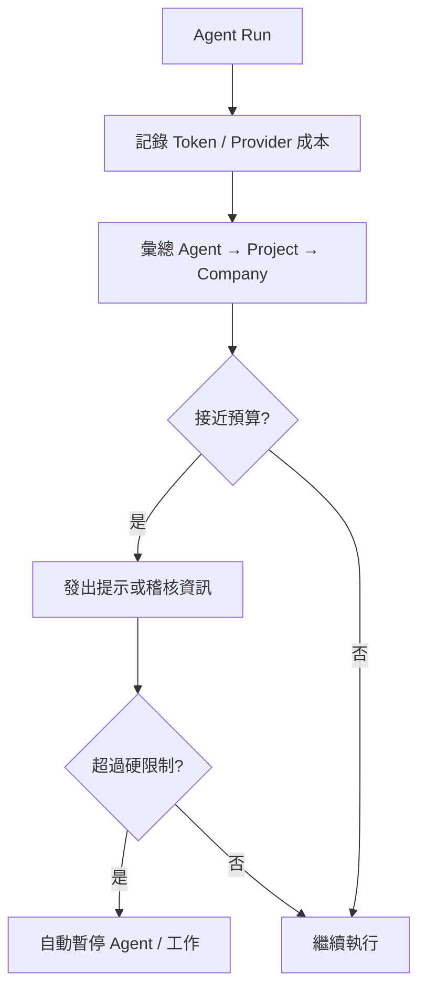

# 系統架構與權限管理

本文件從整體觀念開始，說明 Paperclip 如何管理公司、Agent、任務、工具與權限。建議第一次閱讀時依序閱讀，不需要先了解資料庫或程式碼。

## 1. 一句話理解 Paperclip

Paperclip 是 **AI 公司的控制平面（control plane）**。

它不只是執行一次 Prompt，而是負責管理：

- 公司與公司目標
- Agent 員工與組織圖
- 任務、專案、留言與工作成果
- Agent 何時被喚醒、目前是否執行中、是否卡住
- 模型成本與預算
- 工具、MCP、Secrets 與外部連線
- 使用者、公司成員與操作權限
- Approval、稽核紀錄與安全政策

Agent 可以在本機 CLI、遠端服務、容器或其他執行環境中運作；Paperclip 負責協調、授權、追蹤與保存結果。

## 2. 先建立四個重要觀念

### 2.1 Instance：一個 Paperclip 服務

Instance 是一個正在運作的 Paperclip 服務。單一 Instance 可以包含多家公司。

### 2.2 Company：組織與資料隔離單位

Company 是 Paperclip 的主要業務邊界。Agent、Project、Issue、Skill、Tool、Secret 與 Environment 通常都屬於某一家 Company。

```text
一個 Paperclip Instance
├── Company A
│   ├── Agents
│   ├── Projects / Issues
│   ├── Tools / Secrets
│   └── Members / Permissions
└── Company B
    ├── Agents
    ├── Projects / Issues
    ├── Tools / Secrets
    └── Members / Permissions
```

Company A 的成員或 Agent 不應直接讀取 Company B 的資料。跨公司存取會被授權檢查拒絕。

### 2.3 Agent：公司的 AI 員工

Agent 具有兩種不同概念：

| 概念 | 意義 | 範例 |
|---|---|---|
| 組織角色 | Agent 在公司中的職稱或職責 | `ceo`、`cto`、`engineer` |
| 權限 Grant | Agent 實際可以執行的操作 | `tasks:assign`、`tools:use` |

`role: engineer` 不代表 Agent 自動擁有所有工程權限。實際操作仍會經過 Company、Agent、Tool Policy、Approval 與 Budget 檢查。

### 2.4 Control Plane 與 Execution Runtime

Paperclip 的核心是控制平面；真正執行模型與工具的是 Adapter 或 Runner。



控制平面保存工作狀態與治理結果；Runtime 回報執行進度、工具呼叫、成本、結果與錯誤。

## 3. 整體系統架構



## 4. 一次工作如何流動

以下是「人類建立任務，交給 OpenCode Agent 執行」的完整流程。



### 4.1 重要執行規則

- 任務通常只有一個 Assignee。
- 進入 `in_progress` 前需要通過 atomic checkout。
- Agent 的 heartbeat 是啟動週期，不代表一定會獲准執行所有工具。
- Budget 超過硬限制時，工作會被自動暫停。
- 需要 Approval 的操作不能只靠 Agent 自己批准。
- 每個重要的變更都應有 Activity 或 Run Log 可追蹤。

## 5. 權限模型總覽

Paperclip 的一次授權判斷可以簡化為：



這是一個概念流程。不同 API 或工具可能使用不同的具體檢查，但 **身分、Company 邊界與操作授權不能被跳過**。

## 6. 人類使用者權限

### 6.1 Deployment Mode

Paperclip 有兩種主要模式：

| 模式 | 適用情境 | 人類驗證 |
|---|---|---|
| `local_trusted` | 個人本機開發 | 本機請求視為 Board Operator |
| `authenticated` | 共用、私有網路或正式環境 | 使用登入 Session |

`local_trusted` 方便快速開始，但不適合驗證多使用者權限。要讓不同人員使用不同權限，請使用 `authenticated`。

```bash
PAPERCLIP_DEPLOYMENT_MODE=authenticated \
PAPERCLIP_BIND=lan \
pnpm paperclipai run
```

### 6.2 Company Member Roles

人類成員的 Company 角色如下：

| 角色 | 建議用途 | 權限概念 |
|---|---|---|
| `owner` | 公司擁有者 | 成員、權限、Agent、工具與環境的完整公司管理 |
| `admin` | 公司管理員 | 日常公司管理，但不一定能管理所有權限 |
| `operator` | 營運、工程、產品人員 | 執行 Agent、任務、工具與流程操作 |
| `viewer` | 主管、客戶、稽核人員 | 以查看為主，不提供管理型 Grant |

角色提供預設 Grant；特定成員仍可透過額外 Grant 做更細的調整。

### 6.3 常見 Permission Keys

#### Agent 與 Skill

```text
agents:create             建立 Agent
agents:configure          修改 Agent 設定
agents:suggest-changes    提議 Agent 設定變更
skills:create             建立或管理 Skill
skills:suggest-changes    提議 Skill 變更
```

#### 使用者與公司治理

```text
users:invite              邀請使用者
users:manage_permissions  修改成員權限
joins:approve             核准 Company 加入申請
```

#### 任務與執行環境

```text
tasks:assign              指派任務
tasks:assign_scope        限制任務指派範圍
tasks:manage_active_checkouts  管理進行中的 checkout
environments:manage       管理執行環境
pipelines:write           修改 Pipeline
```

#### 工具、連線與稽核

```text
tools:use                 使用工具
tools:admin               管理工具
tools:manage_connections  管理工具連線
tools:manage_profiles     管理工具帳號或 Profile
tools:manage_runtime      管理工具執行環境
tools:view_audit          查看工具操作稽核
audit:view_agent_actions  查看 Agent 操作稽核
inbox:manage              管理 Inbox
```

### 6.4 成員管理 CLI

```bash
# 列出 Company 成員
npx paperclipai member list --company-id <company-id>

# 更新成員資料
npx paperclipai member update <member-id> \
  --company-id <company-id> \
  --payload-json '{...}'

# 更新角色與 Grants
npx paperclipai member role-and-grants <member-id> \
  --company-id <company-id> \
  --payload-json '{...}'

# 更新成員權限
npx paperclipai member permissions <member-id> \
  --company-id <company-id> \
  --payload-json '{...}'
```

## 7. Agent 身分與權限

Agent 的 API 身分與人類使用者不同。

### 7.1 Run JWT

Heartbeat 執行期間，Agent 可取得短期 JWT：

```http
Authorization: Bearer <PAPERCLIP_API_KEY>
```

此 Token 通常限制在：

- 特定 Agent
- 特定 Company
- 特定 Run

### 7.2 Agent API Key

需要長期連線時，可以建立 Agent API Key：

```http
POST /api/agents/{agentId}/keys
```

安全規則：

- Key 綁定 Agent 與 Company。
- 完整明文只在建立時顯示一次。
- Server 儲存 Hash，不儲存明文。
- Key 可以撤銷。
- Agent 不能用自己的 Key 跨 Company 存取資料。

### 7.3 Agent 自我識別

```http
GET /api/agents/me
```

此 API 可取得目前 Agent 的：

- Agent ID
- Company ID
- 組織角色
- 上級鏈（chain of command）
- 預算與已用金額

## 8. Tool、MCP 與 Secret 的權限

Agent 有 `tools:use` 不等於可以使用所有工具。工具操作通常還要通過：

1. Agent 是否被授權使用該工具。
2. Tool Connection 是否屬於相同 Company。
3. App 或 MCP Action 是否啟用。
4. 該動作的政策是否為 `Allowed`、`Ask first` 或 `Off`。
5. 所需 Secret 是否已授權給該 Agent。
6. 是否需要人類 Approval。
7. 是否仍在預算範圍內。


建議採取最小權限：

| Agent 類型 | 可以開放 | 建議限制 |
|---|---|---|
| Engineer | Repository、Issue、CI | 禁止財務與生產 Secrets |
| Finance | 財務或報表 Tool | 禁止 Git push 與主機執行命令 |
| Support | CRM、客服工具 | 禁止讀取工程 Repository |
| Reviewer | Audit、Reports | 不給寫入與執行權限 |

## 9. Approval、Budget 與 Pause

權限 Grant 不是唯一的安全控制。

### Approval

某個人或 Agent 有操作權限，不表示高風險動作一定會立即執行。依公司政策，可能需要 Board 或其他授權者核准。

典型情境：

- 新增或聘用 Agent
- 修改 Agent 的執行設定
- 使用高權限工具
- 讀取敏感 Secret
- 對外發佈或修改正式環境

### Budget

Company 與 Agent 都可以追蹤成本與月度預算。預算流程大致如下：



### Pause

Board 可以暫停 Agent 或任務。Budget 硬限制也可能觸發自動暫停。暫停狀態應優先於一般執行請求，直到明確 Resume。

## 10. OpenCode CLI 整合

Paperclip 內建 `opencode_local` Adapter。

### 10.1 執行位置

```text
Paperclip Server 主機
    └── opencode_local Adapter
          └── 啟動 / 恢復 opencode CLI
                └── 讀取工作目錄、模型與 Agent context
```

Paperclip 不會在瀏覽器中執行 OpenCode。`opencode` 必須安裝在執行 Paperclip Server 的那台主機，並且該程序的 PATH 能找到它。

### 10.2 基本設定

建立 Agent 時設定：

```json
{
  "adapterType": "opencode_local",
  "adapterConfig": {
    "cwd": "/path/to/project",
    "model": "provider/model"
  }
}
```

模型必須是完整的 `provider/model` 格式，例如：

```text
anthropic/claude-sonnet-5-5
azure/claude-sonnet-5-5
openai/gpt-5
```

可先在同一台主機確認：

```bash
opencode --version
opencode models
```

Paperclip 的 `opencode_local` 會從 `opencode models` 發現模型，並驗證設定的模型是否可用。

### 10.3 直接測試 OpenCode

```bash
opencode run \
  --model anthropic/claude-sonnet-5-5 \
  "請檢查目前專案的測試狀態"
```

Paperclip Agent 使用的模型則應填在該 Agent 的 `adapterConfig.model`，不要只依賴使用者個人的 CLI 預設模型。

## 11. 建議的公司權限配置

### 小型團隊

```text
Owner
├── Admin：管理 Agent、工具與日常設定
├── Operator：建立任務、執行 Agent、查看稽核
└── Viewer：查看狀態與成果
```

### 工程與營運分離

```text
Owner
├── Engineering Admin
│   ├── agents:create
│   ├── agents:configure
│   ├── tasks:assign
│   └── tools:use
└── Operations Operator
    ├── tasks:assign
    ├── tools:manage_connections
    └── audit:view_agent_actions
```

### 高風險工具隔離

```text
一般 Agent
    └── 只允許 tools:use + 低風險 MCP Actions

受控 Agent
    └── 高權限 Tool + 必須 Ask first

Board / Owner
    └── tools:admin + Approval 決策
```

## 12. 安全檢查清單

### 開發環境

- [ ] `local_trusted` 只用於本機或可信任環境。
- [ ] 不把本機服務直接暴露到網際網路。
- [ ] 確認 OpenCode、其他 CLI 與 Paperclip 使用同一個作業系統使用者。
- [ ] 確認 Agent `cwd` 只指向預期的工作區。
- [ ] 不把 API Key 或 Secret 寫入 Git。

### 共用或正式環境

- [ ] 使用 `authenticated` 模式。
- [ ] 為每位人員建立正確的 Company membership。
- [ ] 只給需要的 Role 與 Permission Grant。
- [ ] 對高風險 Tool 設定 `Ask first` 或 Approval。
- [ ] Agent 使用單獨的 API Key，並可個別撤銷。
- [ ] 為 Company 與 Agent 設定 Budget。
- [ ] 定期查看 Activity、Run Log 與 Tool Audit。
- [ ] 確認資料庫與 Object Storage 有持久化與備份。

## 13. 常見問題排查

### Agent 顯示已指派，但沒有開始執行

依序檢查：

1. Agent 是否為 `active` 或 `idle`。
2. Agent 是否被暫停。
3. Issue 是否已有其他執行中的 checkout。
4. Agent 是否有正確的 Company 與任務存取權。
5. 是否卡在 Approval。
6. Company 或 Agent Budget 是否已達硬限制。
7. Adapter 的 CLI 是否存在且可執行。
8. `opencode models` 是否能列出設定的模型。
9. Agent 的 `cwd` 是否存在且可讀寫。
10. Run Log 或 Activity 是否顯示拒絕原因。

### Paperclip 找不到 OpenCode 模型

```bash
which opencode
opencode --version
opencode models
```

這些命令必須在 **Paperclip Server 使用的同一個作業系統環境**中成功。GUI 使用者自己的 Shell 能執行，不代表背景服務一定能找到相同的 PATH 或設定檔。

### 使用者看得到 Company，但不能操作資源

確認：

- 使用者是否仍是該 Company 的有效成員。
- 成員角色是否為 `viewer`。
- 是否缺少對應 Permission Grant。
- 目標 Project 或 Issue 是否為 private。
- 操作是否需要 Approval。

## 14. 重要 API 入口

| 目的 | API |
|---|---|
| 目前 Agent 身分 | `GET /api/agents/me` |
| 建立 Agent | `POST /api/companies/{companyId}/agents` |
| 取得 Agent | `GET /api/agents/{agentId}` |
| 建立 Agent API Key | `POST /api/agents/{agentId}/keys` |
| 取得 Adapter 模型 | `GET /api/companies/{companyId}/adapters/{adapterType}/models` |
| 手動觸發 Heartbeat | `POST /api/agents/{agentId}/heartbeat/invoke` |
| 公司 Agent 清單 | `GET /api/companies/{companyId}/agents` |

所有受保護 API 都應使用適當的 Board Session、Board API Key 或 Agent Bearer Token；不能只因為知道 URL 就視為已授權。

## 15. 相關文件

- [What is Paperclip](what-is-paperclip)
- [Architecture](architecture)
- [Authentication](../api/authentication)
- [Agents API](../api/agents)
- [Managing Agents](../guides/board-operator/managing-agents)
- [Deployment Modes](../deploy/deployment-modes)
- [Agent Runtime](../agents-runtime)
- [Adapters Overview](../adapters/overview)
- [OpenCode MCP](../../doc/public-mcp.md)
- [V1 Implementation Spec](../../doc/SPEC-implementation.md)
